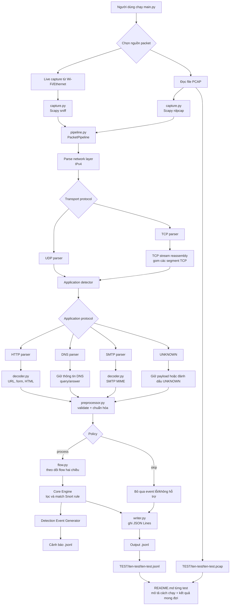

# NT204.R11.ANTN_NguyenDangKhoa_24520825

## Thông tin

- Họ và tên: Nguyễn Đăng Khoa
- MSSV: 24520825
- Lớp: NT204.R11.ANTN
- Bài tập 1-3: Packet Capture, Parser, Decoder, Preprocessor, Flow Tracker và Core Engine cho hệ thống IDS

## Giới thiệu

Module Python thu thập packet từ network interface hoặc file PCAP, đưa cả hai nguồn qua cùng một pipeline và ghi kết quả chuẩn hóa dưới dạng JSON Lines.

Chức năng hiện tại:

- Live capture và PCAP import bằng Scapy.
- Parse IPv4, TCP và UDP.
- Nhận diện HTTP/1.x bằng payload (kể cả port không tiêu chuẩn) và port gợi ý.
- TCP stream reassembly có giới hạn bộ nhớ, xử lý out-of-order và retransmission.
- Parse HTTP request/response, DNS query/response và SMTP command/response.
- Decode HTTP URL/form/HTML và SMTP MIME cơ bản.
- Preprocessor kiểm tra field bắt buộc, chuẩn hóa IP/protocol/domain/header/timestamp và đánh dấu event `valid`, `partial` hoặc `invalid`.
- Flow Tracker gom packet hai chiều vào cùng `flow_id`, theo dõi TCP state, thống kê packet/byte và timeout flow.
- Core Engine đọc Snort `.rules`, lọc rule theo header, so khớp packet/flow/content và sinh Detection Event.
- Chuẩn hóa TCP flags, header và payload.
- Lưu payload dạng UTF-8 hoặc hex nếu không decode được.
- Không để các module phía sau phụ thuộc trực tiếp vào Scapy packet.

```text
Live/PCAP -> IPv4 -> TCP/UDP -> Reassembly -> Decoder -> Preprocessor -> Flow Tracker -> Rule Engine -> JSONL
```

## Sơ đồ tổng thể



## Cài đặt

Yêu cầu Python 3.10 trở lên. Live capture trên Windows cần Npcap và có thể cần chạy PowerShell bằng quyền Administrator.

```powershell
git clone https://github.com/ComGa999ms/NT204.R11.ANTN_NguyenDangKhoa_24520825.git
cd NT204.R11.ANTN_NguyenDangKhoa_24520825
python -m pip install -r requirements.txt
```

## Sử dụng

Xem các network interface:

```powershell
python main.py --list-interfaces
```

Đọc tối đa 10 packet từ PCAP:

```powershell
python main.py --pcap challenge.pcap --count 10 --output TEST/pcap-capture.jsonl
```

Bắt 10 packet từ Wi-Fi:

```powershell
python main.py --interface "Wi-Fi" --count 10 --output TEST/wifi-capture.jsonl
```

Live capture với BPF filter:

```powershell
python main.py --interface "Wi-Fi" --filter "tcp or udp" --count 20 --output TEST/filtered-capture.jsonl
```

Đổi cách xử lý event lỗi hoặc protocol chưa hỗ trợ:

```powershell
python main.py --pcap challenge.pcap --unsupported-policy skip --invalid-policy mark --output TEST/pcap-capture.jsonl
```

Đổi timeout cho flow:

```powershell
python main.py --pcap challenge.pcap --flow-timeout 30 --output TEST/pcap-capture.jsonl
```

Demo Core Engine với hai rule khớp cùng một HTTP packet:

```powershell
python main.py --pcap TEST/http-get/http-get.pcap --rules TEST/BT3/demo.rules --output TEST/BT3/packets.jsonl --alerts-output TEST/BT3/detections.jsonl
```

`--rules` có thể lặp lại để nạp nhiều file. `--disable-sid 300001` tắt một rule theo SID. Khi không có `--rules`, pipeline cũ chỉ ghi packet event. Khi có rule, packet event thêm `detections` và file cảnh báo chứa một Detection Event trên mỗi dòng. Rule lỗi hoặc keyword ngoài phạm vi được báo trên stderr; các rule hợp lệ còn lại vẫn chạy.

Core Engine hiện hỗ trợ `alert` với TCP/UDP, IPv4/CIDR, port đơn/range/`any`, `->`/`<>`, `msg`, `sid`, `rev`, `content`, `nocase`, `offset`, `depth`, `distance`, `within`, `flags`, `dsize`, `flow`, `classtype`, `priority`. `content` dùng bytes TCP đã ghép hoặc UDP payload; chỉ dùng field ứng dụng đã parse khi payload không có. TLS decryption, `pcre` và các keyword ngoài phạm vi bài không được hỗ trợ.

Xem toàn bộ tùy chọn:

```powershell
python main.py --help
```

## Output

Mỗi dòng trong file output là một JSON object độc lập:

```json
{
  "packet_id": 1,
  "timestamp": "2026-05-17T07:08:02.853581Z",
  "capture": {"mode": "pcap", "source": "challenge.pcap"},
  "packet_length": 56,
  "network": {
    "protocol": "IPv4",
    "source_ip": "127.0.0.1",
    "destination_ip": "127.0.0.1",
    "ttl": 128
  },
  "transport": {
    "protocol": "TCP",
    "source_port": 62763,
    "destination_port": 13371,
    "flags": {"syn": true, "ack": false},
    "payload_length": 0
  },
  "application": {"protocol": "UNKNOWN", "fields": {}},
  "payload": {"length": 0, "encoding": null, "data": null},
  "status": "parsed",
  "errors": [],
  "preprocess_status": "valid",
  "processing_action": "process",
  "reason": null,
  "flow": {
    "flow_id": "e1b7b565a19f6d3e",
    "protocol": "TCP",
    "direction": "a_to_b",
    "packet_count": 1,
    "byte_count": 40,
    "tcp_state": "SYN_SENT"
  },
  "expired_flows": []
}
```

Object thực tế chứa thêm các trường chi tiết của IPv4, TCP hoặc UDP. `application.protocol` có thể là `HTTP`, `DNS`, `SMTP` hoặc `UNKNOWN`. Message chưa đủ dữ liệu được giữ trong TCP reassembly buffer và đánh dấu `partial`. Preprocessor có thể giữ event lỗi để xem lý do hoặc bỏ qua khi chọn policy `skip`. Flow timeout được xuất trong `expired_flows`.

## Kiểm thử

```powershell
python -m pytest
```

Chạy chi tiết:

```powershell
python -m pytest -v
```

Các test hiện bao phủ capture, IPv4, TCP/UDP, stream reassembly, HTTP, DNS, SMTP, decoder, preprocessor, flow tracker, rule parser/loader, matching và pipeline integration.

## Cấu trúc chính

```text
main.py                         CLI entry point
src/ids_parser/capture.py       Live capture và PCAP reader
src/ids_parser/pipeline.py      Pipeline xử lý chung
src/ids_parser/reassembly.py    TCP stream reassembly
src/ids_parser/models.py        Normalized IDS event
src/ids_parser/detector.py       Nhận diện application protocol
src/ids_parser/decoder.py        Decode dữ liệu application layer
src/ids_parser/preprocessor.py   Validate và chuẩn hóa event
src/ids_parser/flow.py           Theo dõi flow/connection
src/ids_parser/rules.py          Đọc, parse và validate Snort rule
src/ids_parser/core_engine.py    Index, match, evaluate rule và tạo Detection Event
src/ids_parser/parsers/         IPv4, TCP, UDP, HTTP, DNS và SMTP parsers
src/ids_parser/writer.py        JSON Lines writer
tests/                          Automated tests
TEST/                           Kết quả test case
```

## Khai báo sử dụng AI

- Công cụ: OpenAI Codex 5.6 Sol.
- AI hỗ trợ 70%: xây dựng parser, pipeline, TCP reassembly, Core Engine Bài tập 3, test case và tài liệu.
- Sinh viên 30%: phân tích yêu cầu, chạy thử live/PCAP, kiểm tra kết quả, chỉnh sửa, commit và push mã nguồn.
